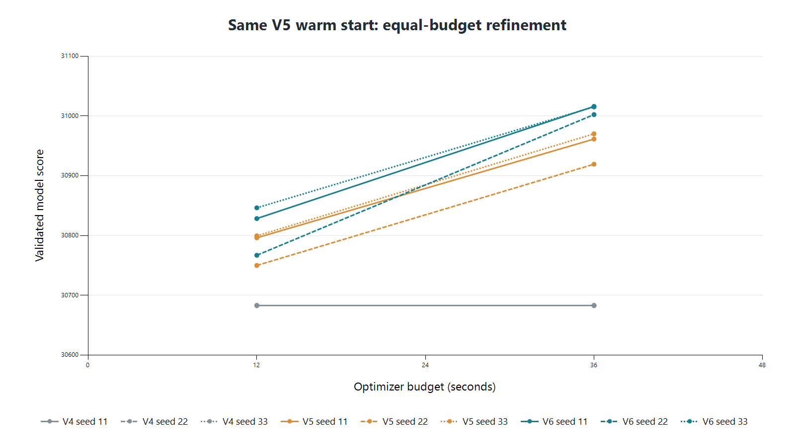
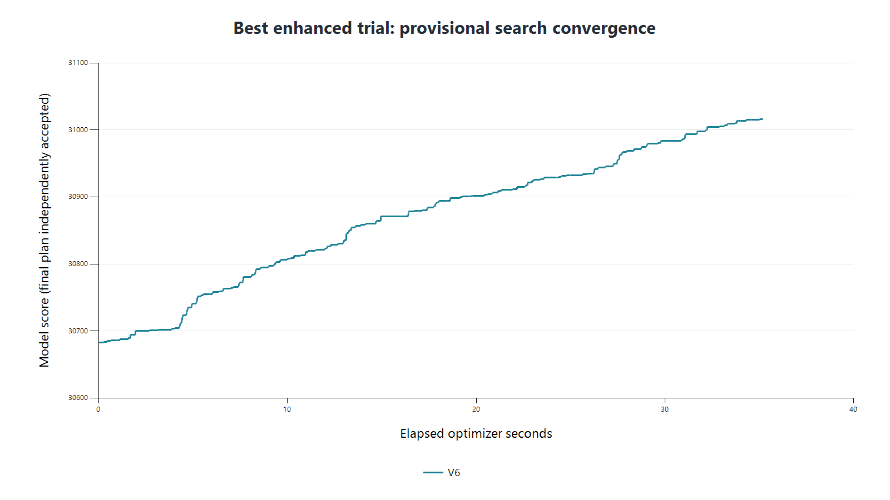
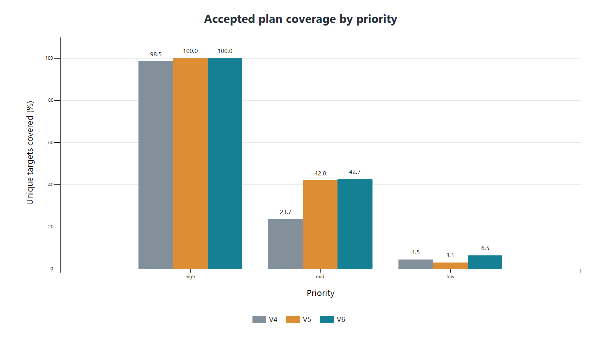
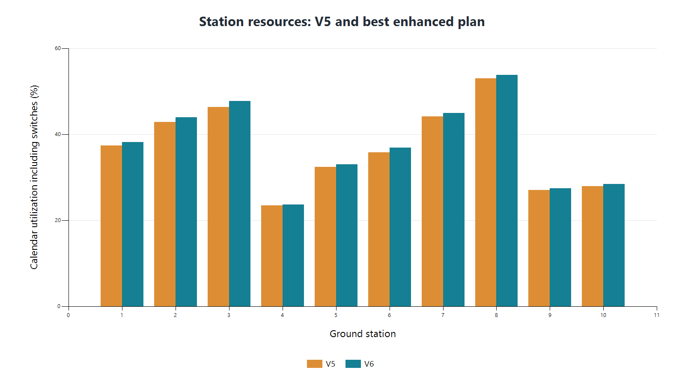

# 赛题四：V4/V5/V6竞赛技术报告

## 真实数据与结果

10000颗真实卫星，10个地面站，2026-08-01至08-07 UTC，6天，复用531432段缓存窗口。目标高2024、中3990、低3986。输入版本逐项SHA见provenance，原始TLE不上传Git。本轮不重做全目标轨道传播、不调用外部AI，也不开发V7。

|历史验收方案|得分|任务|总覆盖|高/中/低覆盖|
|---|---:|---:|---:|---|
|V4|29443.647526|6849|3117|1994/945/178|
|V5|30682.990430|7658|3822|2024/1675/123|
|V6得分优先|31015.978086|7877|3987|2024/1705/258|
|本轮覆盖优先（V5延续）|30961.386198|7919|4100|2024/1976/100|

V4→V5增加1239.342903（4.2092%）；验收V5→最佳V6增加332.987656（1.08525%）；V4→V6增加1572.330560。历史各最佳采用不同既有搜索过程，不能把这张表当作等预算对照。

## 算法演进与实际创新

V4使用窗口预处理、贪心与保守本地搜索，频繁整表检查，固定最长候选会错过短空隙。V5引入有序站点/目标时间索引、增量计分、可变合法时长插入、冲突替换、少量任务迁移与局部重排；逐移动作物理检查，最终全表独立审计。其全局候选次序先未覆盖、再优先级，使未覆盖中优得到更早尝试。

V6在独立模块复用V5状态结构但保留原V4/V5实现：48窗口批量按当前可得收益与小型未覆盖偏好排序；重复观测仍可在冷却后获益。允许起点平移、合法延长/缩短、最多4个冲突任务的逐级跨站迁移；破坏单站6/10/16/24项或双站最多60项，再从本地区间及被移出目标的其他站点窗口重建。重建交替尝试120秒密集排列和最长合法时长，不固定“越长越好”。算子概率由实际单位时间收益平滑更新，保留探索下限。

增量冲突检测用bisect定位站点和同星时间轴附近任务，站点间隔30秒、同星跨站冷却172800秒；增加/删除任务维护计分和覆盖计数。接受事务必须当前模型得分不降，平分时覆盖增加，并保护已覆盖高优目标。物理失败、超时或部分插入冲突都回滚。最终rules整表验证与独立物理审计不依赖这些增量缓存，避免增量错误自证。

最佳36秒seed11的真实贡献：自由插入97次 +155.403320分；冲突链107次 +78.823529；大邻域重排9次 +34.825781；平移/延长110次 +63.165690；直接替换2次 +0.769336。可直接按UID追踪29次跨站迁移，最大已接受重建涉及24项旧任务。并不把尝试过但未接受的邻域说成有效改进。完整trace及操作贡献表保留在原V6 ZIP。

## 18次公平实验

共同起点是验收V5，而非各算法各自的历史基准；预算12/36秒，种子11/22/33，算法V4/V5/V6，共18次。V4保持其原score+0.25coverage接受逻辑，V5保持原算法，V6按冻结收益接受；共同最终验收/低于基准回退规则。12秒pilot与启动测试并行的首次V4记录不进入正式统计，该V4独立重跑。正式18次全部accepted，0回退，0硬约束违规，全部物理通过。

|预算s|优化器|得分均值±样本std|平均覆盖|平均任务|搜索s|最高RSS MiB|平均流程s|
|---:|---|---:|---:|---:|---:|---:|---:|
|12|V4|30682.990430 ± 0.000000|3822.00|7658.00|11.784|368.32|107.40|
|12|V5|30781.911762 ± 27.707034|3920.67|7747.67|12.011|282.50|105.79|
|12|V6|30813.936068 ± 41.589225|3882.33|7734.00|12.011|268.58|108.03|
|36|V4|30682.990430 ± 0.000000|3822.00|7658.00|32.961|370.52|128.70|
|36|V5|30950.288759 ± 27.173546|4079.00|7899.33|36.011|284.76|134.31|
|36|V6|31011.169323 ± 7.685020|3979.67|7868.00|36.010|267.39|135.14|

V6在6组成对得分对照中全部高于同种子V5；36秒均值增益60.880564分。V6的36秒样本std7.685020，小于该档V5的27.173546；12秒V6 std反而较大，不能只选较好的稳定性数字宣称所有预算更稳。

计时：搜索预算包括算法内部索引/候选准备、增量检查和移动物理检查；公共数据读取、物理引擎初始化及最终审计在外。实际搜索耗时单列；V4为避免整次检查超时保守提前结束，V5/V6最后一个有限操作可略超时。流程s从身份哈希完成后开始，含解析、搜索及审计，不含进程启动和之前的哈希。RSS每0.1秒采样，可能漏掉短峰；同轮相同16逻辑/8物理核心Windows机器、BLAS/OMP单线程。原V4约56.1分钟含全量传播，不能和这里36秒优化器直接比较。

## “V5平均覆盖更多，但V6最佳比旧V5覆盖更多”并不矛盾

3987>3822比较的是新V6与原来封存、尚未继续搜索的V5；公平36秒比较中V5也继续搜索，平均4079>V6的3979.67，单次最高4100。参照物不同。V6提高纯任务收益不等价于最大化独特目标数量；重复高优观测及更有收益的时长/交换可提高总分而牺牲一些新中优覆盖。best V6相对覆盖备选：中优1705比1976少271，低优258比100多158，高优相同；总覆盖少113，得分高54.591888。

V5原低优178→123的损失已由旧任务被中/高优阻塞记录解释；V6最佳低优回升到258。非支配方案保留，不用覆盖奖励改写最终得分。覆盖优先方案明确来源于V5延续，而非V6本身额外试验。

## 独立验证与复现

本轮从完整a40b3eb bundle建立独立克隆，再合入最新main的目录清理；冻结src/satplan和原审计/runner相对a40b3eb无代码变化。独立Windows x64 CPython3.12.10 venv中导入精确离线分发文件，10包路径均属于新venv，pip check成功；授权原始输入/星历/缓存SHA通过；51项测试0跳过。

当前本地Evaluator coverage_weight=0与独立CSV算术都重得两套分数，完整硬约束0违规。本轮又直接对最终交付CSV执行独立Skyfield全区间1秒及精确端点检查：7877/7877、7919/7919通过；仰角、暗夜、卫星照射和SGP4错误计数全部为0。冷却/站点切换由冻结rules另行整表检查。新物理审计报告路径直接指向稳定版最终CSV，无需仅依赖旧证书别名绑定。

本轮1秒工具链冒烟从封存V5开始，通过完整验收并成功识别已完成trial。它只验证工程入口与恢复，不算入正式18次，也不替换任何基准。本轮没有在新环境重跑36秒正式搜索；原始最佳CSV可精确恢复，但墙钟搜索在不同机器不保证相同迭代序列。联网pip因PyPI超时未验证，离线导入实际验证；GitHub写权限/推送/PR仍待授权登录和用户确认。

## 假设、数据质量与局限

详见V6_FROZEN_RULES.md。线性时长插值、30秒切换、太阳高度严格小于-6度以及赛事总分与覆盖如何合成仍须官方最终确认；不能把当前任务收益总和称为官方最终竞赛总分。规划期来自用户最新确认，未独立拿到主办方原公告；TLE格式与题面AOE差异需确认。全局48小时冷却按项目已有答疑实现。

真实TLE历元Aug2–4用于Aug1–7有外推误差；原数据中的26702衰减点已在旧传播中屏蔽，调度审计未出现SGP4错误。30秒窗口粗扫会漏掉过顶/光照短违例，缓存只是候选；最终1秒检查通过不是连续时间严格认证，也不是实测轨道精度证明。目标覆盖低可能来自资源竞争及优化策略，不能把固定计划下阻塞当作目标物理不可见。

当前src/scoring.py部分非本轮入口仍保留NotImplemented占位；正式Evaluator、验收与公平比较用已验证rules/optimize及专用脚本，不宣称所有历史项目接口均已实现。下一阶段没有用未经验证的新算法成绩替换此稳定版。

## 实验图表

